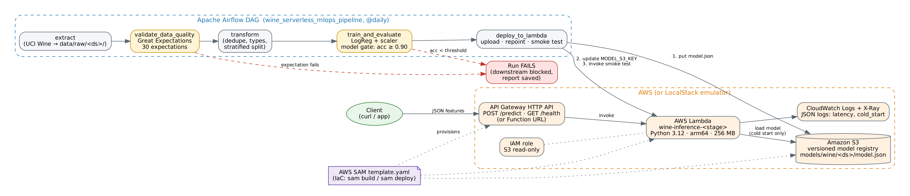

# Serverless Model Deployment & Pipeline Orchestration on AWS

DAM405 Machine Learning Operations, Programming Assignment 4.

A wine-cultivar classifier is trained by an **Apache Airflow** pipeline that includes a
**Great Expectations** data-quality gate. The pipeline deploys the model to an **AWS Lambda** function,
which is defined as code with **AWS SAM** and served through **API Gateway**.



```
extract ──► validate_data_quality ──► transform ──► train_and_evaluate ──► deploy_to_lambda
            (Great Expectations,                    (model gate:           (S3 upload → repoint
             30 expectations)                         accuracy ≥ 0.90)       Lambda → smoke test)
```

## Repository layout

| Path | What it is |
|---|---|
| `src/inference/app.py` | Lambda handler. Pure Python, so the package needs no dependencies. Supports API Gateway, function URLs and direct invocation |
| `src/inference/model/model.json` | Model bundled with the function (the fallback when no S3 key is set) |
| `template.yaml`, `samconfig.toml` | **IaC**: AWS SAM template (Lambda, HTTP API, versioned S3 bucket, IAM, log group) |
| `scripts/deploy_localstack.sh` | **IaC (CLI)**: idempotent AWS CLI deployment to LocalStack |
| `dags/wine_mlops_pipeline.py` | Airflow DAG (TaskFlow API, works on Airflow 3.x and 2.x) |
| `pipeline/` | Task logic: `extract`, `validate` (GX), `transform`, `train`, `deploy` |
| `events/` | Sample events: direct invoke, API Gateway v2, bad request |
| `scripts/invoke.sh` | Invokes the deployed function and saves responses and logs to `docs/evidence/` |
| `scripts/cold_start_benchmark.py` | Measures cold vs warm latency for the trade-off analysis |
| `scripts/run_pipeline_local.py` | Runs the whole pipeline without Airflow |
| `tests/` | 18 pytest tests (handler, quality gate, idempotency, model parity, deploy) |
| `docs/report_draft.md` | Report skeleton following the brief |

## 1. Setup

Requires Python 3.11 or 3.12.

```bash
python -m venv .venv && source .venv/bin/activate      # Windows: .venv\Scripts\activate
pip install -r requirements.txt
pytest -q                                              # 18 tests should pass
python scripts/run_pipeline_local.py                   # one end-to-end run, no Airflow/AWS needed
python scripts/run_pipeline_local.py --bad-data        # shows the quality gate stopping the run
```

## 2. Serverless inference: choose ONE target

### Option A: Real AWS with SAM (preferred if you have an account)
```bash
aws configure                       # credentials stay in ~/.aws, never in the repo
sam validate --lint
sam build
sam deploy --guided                 # first time; afterwards just `sam deploy`
# Note the outputs PredictUrl, FunctionName and ModelBucketName.
./scripts/invoke.sh aws <PredictUrl>
curl -X POST <PredictUrl> -H 'Content-Type: application/json' -d @events/direct_invoke.json
```
To clean up afterwards: `sam delete` (empty the model bucket first).

### Option B: AWS SAM local (no account needed, needs Docker)
```bash
sam build
sam local invoke InferenceFunction -e events/direct_invoke.json
sam local invoke InferenceFunction -e events/apigw_predict.json
sam local start-api                 # then in another terminal:
curl -X POST http://127.0.0.1:3000/predict -H 'Content-Type: application/json' -d @events/direct_invoke.json
```

### Option C: LocalStack (emulated S3 + Lambda, needs Docker)
Since March 2026 LocalStack needs a free auth token from app.localstack.cloud (Hobby tier).
```bash
export LOCALSTACK_AUTH_TOKEN=ls-...          # keep it in your shell or .env, never in code
docker compose up -d
pip install awscli                           # if `aws` is not installed
./scripts/deploy_localstack.sh
./scripts/invoke.sh localstack
```

## 3. Orchestration with Airflow

```bash
# separate venv recommended (Airflow pins many dependencies)
pip install "apache-airflow==3.1.8" --constraint \
  "https://raw.githubusercontent.com/apache/airflow/constraints-3.1.8/constraints-3.12.txt"
pip install -r requirements.txt

export AIRFLOW_HOME=$PWD/airflow_home
export AIRFLOW__CORE__DAGS_FOLDER=$PWD/dags
export AIRFLOW__CORE__LOAD_EXAMPLES=False
export PYTHONPATH=$PWD                       # so the DAG can import the `pipeline` package

# Choose where deploy_to_lambda deploys:
export DEPLOY_MODE=local                     # no AWS needed
# export DEPLOY_MODE=aws MODEL_BUCKET=<ModelBucketName> LAMBDA_FUNCTION_NAME=<FunctionName>
# export AWS_ENDPOINT_URL=http://localhost:4566    # add this for LocalStack

# quick CLI run (good for logs as evidence)
airflow dags test wine_serverless_mlops_pipeline 2026-11-06
airflow dags test wine_serverless_mlops_pipeline 2026-11-05 --conf '{"inject_bad_rows": true}'

# full UI (screenshots of the Graph/Grid view)
airflow standalone                           # open http://localhost:8080, login printed in the terminal
```
In the UI, trigger the DAG with the default parameters for a green run. Trigger it again with
`inject_bad_rows = true` to show `validate_data_quality` failing and the downstream tasks marked `upstream_failed`.

The outputs of each run go to `data/<stage>/<YYYY-MM-DD>/`:
- `quality/…/validation_report.json`: result of every expectation
- `models/…/model.json` and `metrics.json`
- `deployments/…/deployment.json`: what was deployed and the smoke-test result

## 4. DAG design decisions

- **Idempotent:** output is partitioned by the logical date and overwritten on re-run. The split and training use a fixed seed, and the S3 key depends on the date. Re-running a day gives the same result. This is tested in `test_extract_and_transform_are_idempotent`.
- **Atomic:** each task does one job, and files are written to a temp file and then `os.replace`d. A crash never leaves partial output.
- **No hard-coded secrets:** AWS credentials come from the boto3 credential chain. Settings come from env vars (see `.env.example`), and the LocalStack token stays in your environment.
- **Fail fast:** the data and model gates raise `AirflowFailException`. Retries are skipped and downstream tasks are blocked.
- **Small XComs:** tasks pass file paths, never DataFrames.

## 5. Evidence checklist for the report

- [ ] `docs/evidence/direct_invoke_response.json` and the `http_predict_response.json` from `invoke.sh`
- [ ] Screenshot of the curl call or the Lambda console "Test" result, plus CloudWatch log lines
- [ ] Airflow Graph view of a **successful** run (all five tasks green)
- [ ] Airflow Graph view of a **failed** run (`inject_bad_rows=true`) and the gate's log message
- [ ] `validation_report.json` (or a table of it)
- [ ] `docs/evidence/cold_start.csv` from `scripts/cold_start_benchmark.py` (AWS or LocalStack)
- [ ] `pytest -q` output

## References
- AWS Lambda Developer Guide: https://docs.aws.amazon.com/lambda
- AWS SAM Developer Guide: https://docs.aws.amazon.com/serverless-application-model
- Apache Airflow documentation: https://airflow.apache.org/docs
- Great Expectations (GX Core) documentation: https://docs.greatexpectations.io
- Dataset: Aeberhard, S. & Forina, M. (1991). *Wine* [UCI Machine Learning Repository], loaded via `sklearn.datasets.load_wine`.
