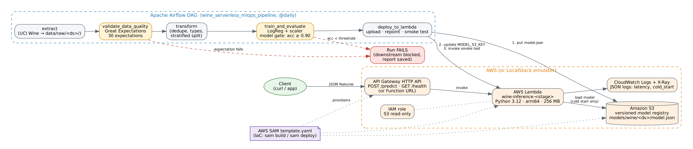

# Serverless Model Deployment & Pipeline Orchestration on AWS

**DAM405 Machine Learning Operations, Programming Assignment 4**
Name: `[your name]` · Student no.: `[student number]` · Repository: `[link to your repo]`
Deployment target used: `[Real AWS (SAM) / AWS SAM local / LocalStack]` *(the brief requires you to state this)*

> Draft. Sections marked `[ ]` need your own screenshots, numbers or wording. Replace the
> example figures with the ones from your own runs.

---

## 1. Introduction

**Problem.** A trained model is only useful when other systems can call it reliably and retraining is
repeatable. This project builds both halves:
- a serverless inference endpoint, so there are no servers to manage and you pay per request
- an orchestrated pipeline that only deploys a new model after the data and the model have passed automated quality gates

**Dataset.** I used the UCI *Wine* dataset (Aeberhard & Forina, 1991), loaded through `sklearn.datasets.load_wine`.
- 178 samples of wine from three cultivars grown in the same region of Italy
- 13 continuous chemical measurements per sample (alcohol, malic acid, flavanoids, proline, …)
- the target is the cultivar (0, 1 or 2)

The dataset is small and clean, so the work can focus on the MLOps tooling, not on model tuning.

**Approach.**
1. An Airflow DAG runs extract → Great Expectations quality gate → transform → train/evaluate (model gate) → deploy.
2. The model is a StandardScaler plus multinomial logistic regression. It is exported as a small JSON file.
3. A pure-Python Lambda handler serves it behind an API Gateway HTTP API.
4. The infrastructure is defined in an AWS SAM template.

## 2. Architecture

*Figure 1. Airflow drives training and deployment. A request from the client goes through API Gateway to Lambda. Lambda loads the approved model version from versioned S3 once per cold start.*

## 3. Serverless design

### 3.1 Handler (`src/inference/app.py`)
- **Model loading.** The model loads once per execution environment, at cold start, and is cached in a module-level variable. Warm invocations skip the load.
  - If `MODEL_S3_BUCKET` and `MODEL_S3_KEY` are set, the model comes from S3.
  - Otherwise the handler uses the copy bundled in the package.
- **Inference with no dependencies.** I exported the scaler means and scales and the logistic-regression weights to JSON. The handler computes the softmax over the class scores in plain Python, so scikit-learn, NumPy and SciPy are not needed at runtime.
  - The package is a few KB instead of about 200 MB.
  - This shortens cold starts and stays well under Lambda's 250 MB unzipped limit.
  - JSON is also safe to load, unlike pickle.
  - A unit test (`test_exported_json_model_matches_sklearn`) checks that the probabilities match scikit-learn to within 1e-3.
- **Input contract.** The body is `{"instances": [{…13 features…}]}` or `{"features": {…}}`.
  - Missing or non-numeric features, malformed JSON and empty batches return **HTTP 400** with a clear message.
  - Unexpected errors return **500** without leaking a stack trace.
- **Observability.** Every prediction writes a structured JSON log line with the request id, batch size, `cold_start`, `latency_ms` and the model version.
  - These are what CloudWatch Logs Insights queries and the cold-start benchmark use.
  - X-Ray tracing is turned on in the template.

### 3.2 Trigger
- An **API Gateway HTTP API** exposes `POST /predict` and `GET /health`.
- The same handler also accepts **function URL** events (used with LocalStack) and **direct invocation** (`aws lambda invoke`). The Airflow deploy task uses direct invocation for its smoke test.
- I chose an HTTP API over a REST API because it is cheaper and has lower latency, and this project needs none of the REST-only features (API keys, request validation models).

### 3.3 Deployment as code
`template.yaml` (AWS SAM) declares:

| Resource | Purpose |
|---|---|
| `InferenceFunction` | Python 3.12, **arm64** (Graviton, cheaper per GB-second), 256 MB, 10 s timeout, JSON logging, X-Ray tracing |
| `InferenceApi` | HTTP API with the two routes |
| `ModelBucket` | Versioned, encrypted, private S3 bucket that acts as a simple model registry |
| IAM (`S3ReadPolicy`) | Least privilege: the function can only *read* the model bucket |
| `InferenceLogGroup` | 14-day log retention, to control cost |

To deploy: `sam build && sam deploy`.
- `scripts/deploy_localstack.sh` does the same with the AWS CLI for the emulator.
- The script is idempotent: it creates resources the first time and updates them on later runs.

`[Insert screenshot: sam deploy output / CloudFormation stack, or deploy_localstack.sh output]`

## 4. Airflow DAG

### 4.1 Tasks and dependencies

`extract >> validate_data_quality >> transform >> train_and_evaluate >> deploy_to_lambda`

| Task | What it does | Output |
|---|---|---|
| `extract` | Loads the source data. Can inject corrupted rows when the `inject_bad_rows` param is set | `data/raw/<ds>/wine.csv` |
| `validate_data_quality` | **Great Expectations gate**: 30 expectations | `data/quality/<ds>/validation_report.json` |
| `transform` | Drops duplicates, fixes types, makes a stratified 75/25 split with a fixed seed | `train.csv`, `test.csv` |
| `train_and_evaluate` | Fits the model, logs accuracy, F1 and the classification report. **Model gate**: accuracy ≥ `MIN_ACCURACY` (0.90) | `model.json`, `metrics.json` |
| `deploy_to_lambda` | Uploads to `s3://…/models/wine/<ds>/model.json`, points the Lambda at the new key, waits for the update, then invokes a smoke test on held-out samples | `deployment.json` |

### 4.2 The data-quality gate
The GX suite checks:
- the schema: the exact column list, in order
- the row count: between 100 and 1,000,000
- no nulls in any of the 14 columns
- a plausible range for each of the 13 features (for example, magnesium between 60 and 180 mg/L)
- that the target is one of {0, 1, 2}

If any expectation fails, the task:
1. saves the full report
2. raises `AirflowFailException`, which fails the task immediately with no retries
3. leaves `transform`, `train_and_evaluate` and `deploy_to_lambda` as `upstream_failed`

Bad data therefore never reaches the model or production.

### 4.3 Best practice
- **Idempotent.** Outputs are partitioned by the logical date and overwritten on re-run. The seeds are fixed and the S3 keys depend on the date. Re-running 2026-11-06 produces byte-identical files, which a test checks.
- **Atomic.** Each task has one responsibility. Files are written to a temp file and renamed with `os.replace`, so a crash never leaves a half-written file.
- **No secrets in code.**
  - AWS credentials come from the boto3 credential chain (profile or IAM role).
  - Configuration comes from environment variables.
  - The LocalStack token is read from the environment by `docker-compose.yml`.
  - `.env` is git-ignored.
- **Other choices.**
  - The DAG file stays thin. All logic lives in a tested `pipeline` package.
  - XComs carry file paths, not data.
  - `catchup=False` and `max_active_runs=1` stop two runs from deploying at the same time.

## 5. AWS service-to-role mapping

| Service | MLOps role in this project |
|---|---|
| AWS Lambda | Model serving / online inference (compute) |
| Amazon API Gateway (HTTP API) | Prediction endpoint: routing, throttling, public HTTPS interface |
| Amazon S3 (versioned) | Artefact store and lightweight **model registry**. Each approved model has a dated key, and versioning allows rollback |
| AWS SAM / CloudFormation | Infrastructure as Code: reproducible, reviewable environments |
| AWS IAM | Least-privilege access (the function can only read models) |
| Amazon CloudWatch Logs (+ X-Ray) | Monitoring: latency, errors, cold starts, model version served |
| Apache Airflow (self-hosted; Amazon MWAA in production) | Orchestration and continuous delivery of models |
| Great Expectations | Data validation / data-quality gate |
| LocalStack / SAM local *(if used)* | Local emulation of the above for development and testing |

## 6. Serverless trade-offs

**Cost.**
- Lambda bills per request plus per GB-second of execution, so an idle endpoint costs close to nothing. That suits a low or bursty prediction load like this one, where a 24/7 EC2 instance or SageMaker endpoint would mostly sit idle.
- arm64 lowers the per-GB-second price.
- At high, steady traffic the per-request model can cost more than a reserved container or instance. The break-even point should be estimated before choosing serverless for a high-volume model. `[optional: a small calculation using the AWS pricing page]`

**Cold starts.**
- The first request to a new execution environment has to start the runtime and load the model. This adds latency to the occasional request.
- My design reduces this with a dependency-free package and a small JSON model.
- `[Insert your numbers from scripts/cold_start_benchmark.py: median cold vs warm latency.]`
- Options for strict latency SLAs: provisioned concurrency (which costs money while idle) or SnapStart.
- Large models (deep learning, LLMs) suffer much worse cold starts. They often need container images, a larger memory setting, or a dedicated endpoint.

**Scaling.**
- Lambda scales out automatically with concurrent requests, with no capacity planning. This suits spiky traffic.
- Limits:
  - per-account concurrency quotas
  - a 15-minute maximum run time
  - a 10 GB memory ceiling and no GPUs, which rules out large models
  - statelessness, so caches and connections must be rebuilt in each new environment
- API Gateway throttling protects downstream systems.

**Operational.**
- There are no servers to patch.
- Deployment and rollback are simple: change `MODEL_S3_KEY`, or redeploy an older S3 version.
- In return you depend on one vendor, and local testing needs emulators.

## 7. Future trend in MLOps

`[Choose one and expand to a paragraph with a citation. Suggested: LLMOps.]`

**LLMOps.** MLOps practices are being extended to large language models. That means prompt and version management, evaluation pipelines in place of single accuracy metrics, guardrails, and cost per token as a key metric. It also increasingly means calling managed model APIs such as Amazon Bedrock from serverless functions instead of hosting the model yourself.
- The quality gates in this project map directly to LLM evaluation gates.
- The Lambda + API Gateway pattern is a common way to put a governed API in front of a hosted LLM.

## 8. Results and evidence

`[Replace with your own run.]` Example from the development run:

| Metric | Value |
|---|---|
| Rows extracted | 178 |
| Expectations passed (clean run) | 30 / 30 |
| Expectations passed (`inject_bad_rows=true`) | 25 / 30: null alcohol, magnesium/hue/proline out of range, unknown target |
| Train / test | 133 / 45 (stratified) |
| Test accuracy / macro-F1 | 1.00 / 1.00 |
| Smoke test after deploy | 3 / 3 correct |
| Unit tests | 18 passed |

- `[Figure: Airflow Graph view, successful run]`
- `[Figure: Airflow Graph view, failed run with validate_data_quality red and downstream upstream_failed]`
- `[Figure/log: successful Lambda invocation (curl or aws lambda invoke) and the CloudWatch log line]`
- `[Table: cold vs warm latency]`

**Discussion.**
- Perfect test accuracy is expected on this small, well-separated dataset. It should not be read as a sign that the model would generalise to other vineyards.
- The more important result is that the gates behave as designed:
  - the corrupted run was stopped before training, and the report pinpointed each failing column
  - the clean run was deployed and then checked against the live function

## 9. Limitations and future work
- **Small, static dataset.** There is no real data drift. Next step: add drift checks (for example, Evidently or a GX distribution expectation) that compare each run with a reference.
- **Simple model registry.** S3 keys are not a full registry. MLflow or the SageMaker Model Registry would add approval stages and lineage.
- **All-at-once rollout.** Lambda aliases with weighted traffic (canary deployment through CodeDeploy) would allow gradual rollout and automatic rollback.
- **Configuration drift.** The DAG changes `MODEL_S3_KEY` outside CloudFormation, so a later `sam deploy` resets it. Better: have the DAG pass the key as a stack parameter, or read the "current" pointer from SSM Parameter Store.
- **No CI/CD.** A GitHub Actions workflow running `pytest`, `cfn-lint` and `sam deploy` on merge would complete the continuous-delivery loop.
- **No authentication.** The endpoint has no auth. Production would add IAM or JWT authorisers and usage plans.

## References
- Aeberhard, S. & Forina, M. (1991). *Wine* [Dataset]. UCI Machine Learning Repository.
- Gift, N. & Deza, A. (2021). *Practical MLOps*. O'Reilly.
- Amazon Web Services. *AWS Lambda Developer Guide*. https://docs.aws.amazon.com/lambda
- Amazon Web Services. *AWS SAM Developer Guide*. https://docs.aws.amazon.com/serverless-application-model
- Apache Software Foundation. *Apache Airflow documentation*. https://airflow.apache.org/docs
- Great Expectations. *GX Core documentation*. https://docs.greatexpectations.io
- Pedregosa, F. et al. (2011). Scikit-learn: Machine Learning in Python. *JMLR*, 12, 2825–2830.

## Declaration of AI use
`[Required by the brief. State which tools you used and for what, following your institution's policy. For example: "Claude (Anthropic) was used to generate an initial project scaffold and report outline. I reviewed, ran, modified and tested all code, and wrote/edited the final report myself."]`
